<div align="center">

# 🔭 Zabbix Network Monitoring Lab

**A small virtual lab that monitors 3 machines with Zabbix and sends e-mail alerts when something goes wrong.**


</div>

<p align="center">
  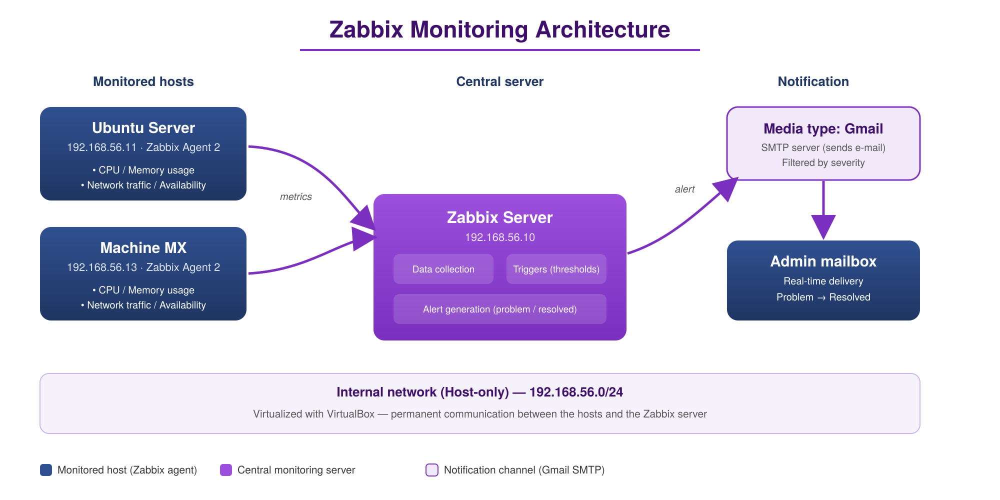
</p>

---

## 📖 Table of contents

- [About the project](#-about-the-project)
- [Architecture](#-architecture)
- [Lab setup](#-lab-setup)
- [How it works](#-how-it-works)
- [Alert tests](#-alert-tests)
- [Results](#-results)
- [What I learned](#-what-i-learned)
- [Ideas for improvement](#-ideas-for-improvement)
- [Repository structure](#-repository-structure)
- [Author](#-author)

---

## 🎯 About the project

Monitoring means watching your servers all the time, so you find out about a problem **before your users do**.

In this project I built a complete monitoring solution with **Zabbix**, an open-source monitoring platform:

- 🖥️ **3 virtual machines** running in VirtualBox, each with a fixed IP address
- 📡 **Zabbix Agent 2** on the monitored machines, sending CPU, memory, network and availability data
- 🧠 **Zabbix Server** that stores the data and applies **triggers** (thresholds)
- 📧 **E-mail alerts** through a Gmail media type: one e-mail when a problem starts, one when it is resolved
- 🧪 **3 failure tests** to prove the whole chain works: agent down, network spike, CPU overload

Everything was first tested in a safe virtual lab, so nothing could break a real network.

---

## 🏗️ Architecture

| Machine | Role | IP address |
|---|---|---|
| **Zabbix Server** | Collects data, runs triggers, sends alerts | `192.168.56.10` |
| **Ubuntu Server** | Monitored host (Zabbix Agent 2) | `192.168.56.11` |
| **Machine MX** | Monitored host (Zabbix Agent 2) | `192.168.56.13` |

All machines are on a VirtualBox **Host-only** network: `192.168.56.0/24`. Fixed IPs matter here: if an address changed, the server would lose the host.

<details>
<summary>📸 Click to see the IP configuration of each machine</summary>

<br>

**Zabbix Server — 192.168.56.10**

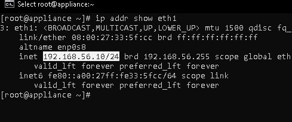

**Ubuntu Server — 192.168.56.11**

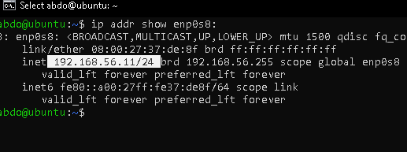

**Machine MX — 192.168.56.13**

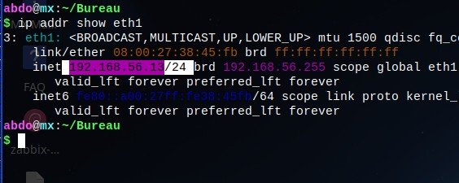

</details>

---

## 🧰 Lab setup

| Component | Details |
|---|---|
| Hypervisor | VirtualBox |
| Monitoring platform | Zabbix 7.x, ready-made Zabbix Appliance (server + web frontend) |
| Agents | Zabbix Agent 2 |
| Templates | `Linux by Zabbix agent` (+ `Zabbix server health` on the server) |
| Notification | Gmail SMTP media type |
| Test tools | `scp`, `stress-ng` |

> 📚 Step-by-step instructions to rebuild this lab: **[docs/setup-guide.md](docs/setup-guide.md)**

---

## ⚙️ How it works

```
 Zabbix Agent 2  ──metrics──▶  Zabbix Server  ──trigger fires──▶  Gmail media type  ──▶  📧 Admin mailbox
 (Ubuntu, MX)                  (192.168.56.10)                     (filtered by severity)
```

1. Each agent sends its metrics to the Zabbix Server.
2. The server compares the values with **triggers**, for example *"CPU above 90% for 5 minutes"*.
3. When a trigger fires, Zabbix creates a **Problem** with a severity.
4. The media type sends an e-mail. When the value goes back to normal, a **Resolved** e-mail is sent automatically.

### 1. Logging in and the Global View

The Global View dashboard shows the state of all servers in real time: CPU, memory, availability.

<p align="center">
  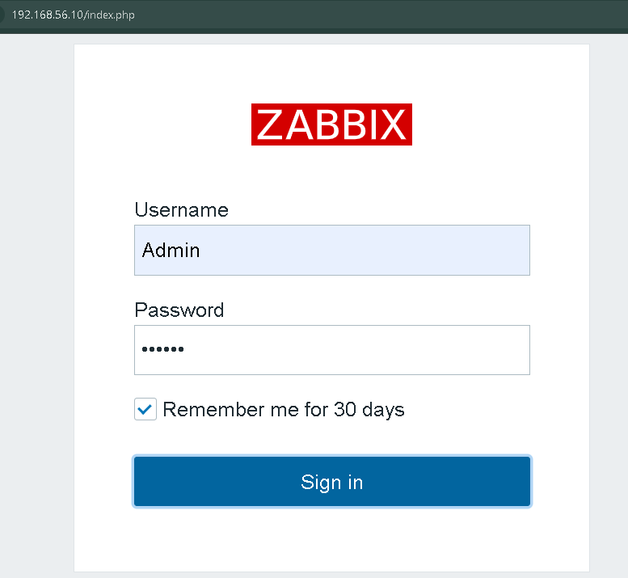
</p>

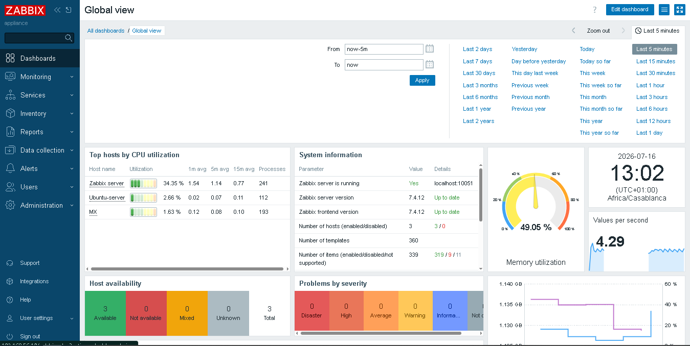

### 2. Hosts

Three hosts were declared, each with its own IP and agent interface. The green **ZBX** badge means the agent is answering.

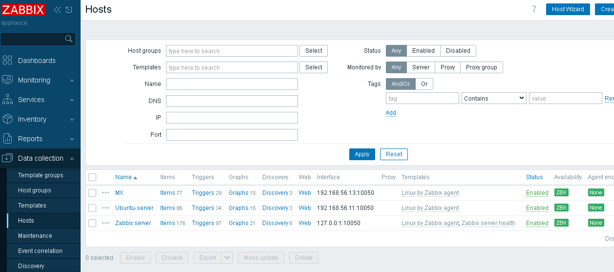

### 3. Live data

*Latest data* shows the most recent value of every item (CPU, memory, ...) for each host.

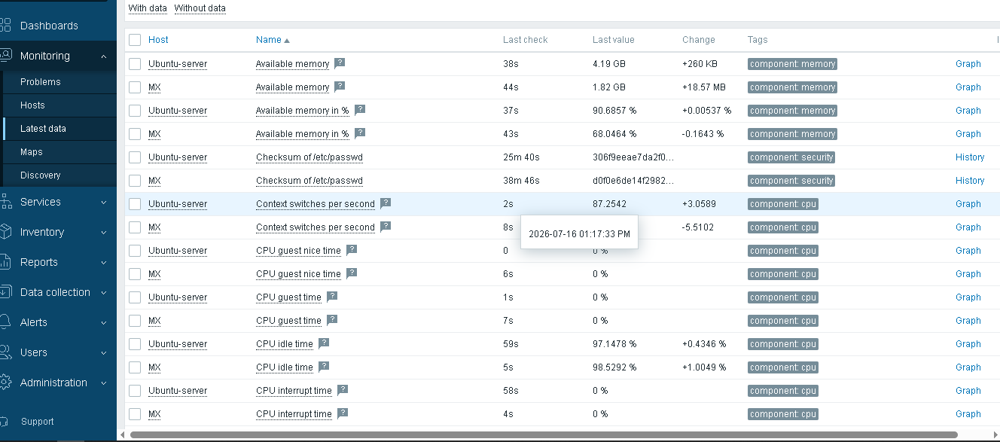

### 4. E-mail alerts

A **Gmail media type** was created, then attached to the admin user. It is active **24/7** and receives every severity level.

| Media type | Attached to the user |
|---|---|
| 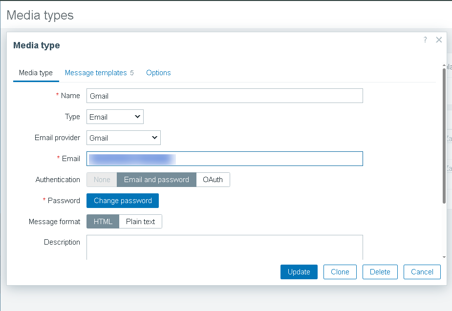 | 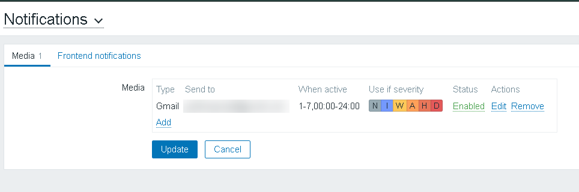 |

---

## 🧪 Alert tests

### Test 1 — Stop the agent (availability)

I stopped the Zabbix agent on the Ubuntu server on purpose.

After 3 minutes with no answer, Zabbix raised **`Linux: Zabbix agent is not available (for 3m)`**. When I restarted the agent, the problem **resolved by itself**, with no manual action.

| Problem detected | Problem resolved |
|---|---|
| 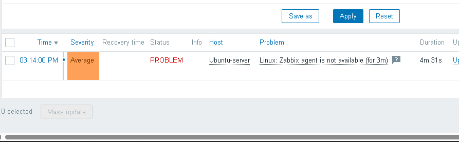 | 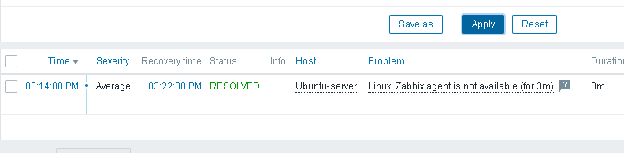 |

And the two e-mails arrived as expected:

| Problem e-mail | Resolved e-mail |
|---|---|
| 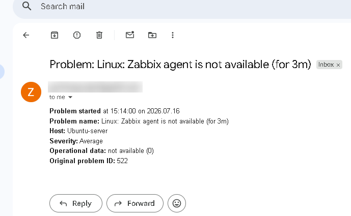 | 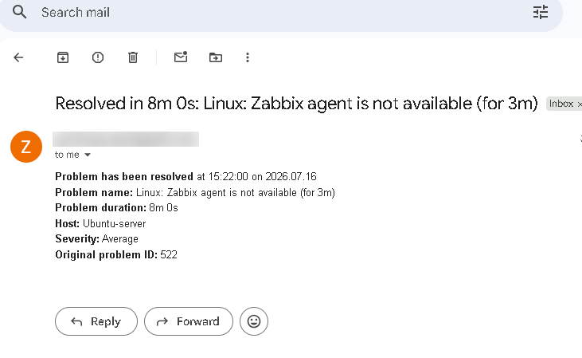 |

### Test 2 — Network traffic spike

I copied a 500 MB file from the MX machine to the Ubuntu server with `scp` to create a traffic peak.

```bash
scp testfile.bin <username>@192.168.56.11:/tmp/
```

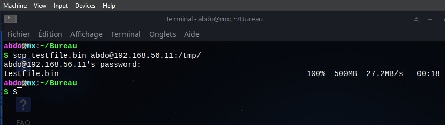

Result: a **`High network traffic on enp0s8`** problem was raised on the Ubuntu server.

### Test 3 — CPU overload

I used `stress-ng` to push every CPU core to 100% for 6 minutes.

```bash
stress-ng --cpu 0 --timeout 360
```

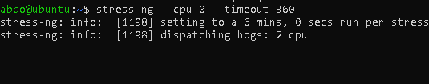

Result: **`Linux: High CPU utilization (over 90% for 5m)`** was raised.

---

## 📊 Results

Every problem detected during the tests, with its exact duration, appears in the Zabbix history.

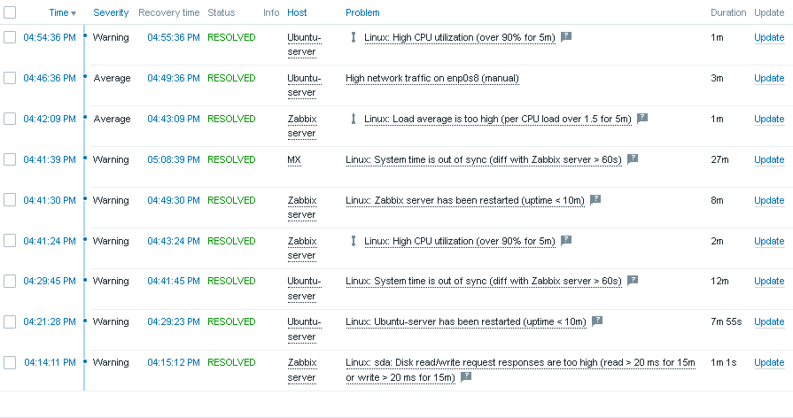

And the mailbox shows the matching alerts:

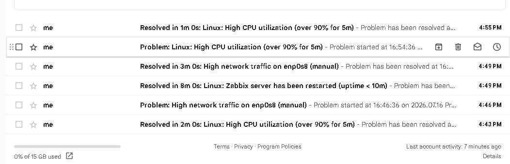

| Test | Trigger | Severity | Alert received |
|---|---|---|---|
| Agent stopped | Zabbix agent is not available (for 3m) | Average | ✅ Problem + Resolved |
| Network spike | High network traffic on enp0s8 | Average | ✅ Problem + Resolved |
| CPU overload | High CPU utilization (over 90% for 5m) | Warning | ✅ Problem + Resolved |

Zabbix also reported a few extra problems that I did not cause on purpose (system time out of sync, a restarted VM, disk response times). That is normal in a small VM lab, and it shows monitoring catches things you did not plan to test.

---

## 💡 What I learned

- How to give virtual machines **fixed IP addresses** on a Host-only network
- How to install and configure **Zabbix Server** and **Zabbix Agent 2**
- How **hosts, items, templates and triggers** fit together
- How to set up **automatic e-mail alerts** (media type, user media, severity filter)
- How to **test a monitoring system** by breaking things on purpose
- Why monitoring matters for **business continuity**

---

## 🚀 Ideas for improvement

- [ ] Add a Telegram or Slack notification channel
- [ ] Monitor network devices with **SNMP** (switches, routers)
- [ ] Add a **Grafana** dashboard on top of Zabbix
- [ ] Add a Windows host
- [ ] Automate the agent install with an Ansible playbook
- [ ] Use Gmail **OAuth** or an app password instead of the account password

---

## 📁 Repository structure

```
zabbix-monitoring-lab/
├── README.md              ← you are here
├── LICENSE
├── .gitignore
└── docs/
    ├── setup-guide.md     ← how to rebuild the lab
    └── images/            ← screenshots and the architecture diagram
```

---

## 👤 Author

**Abdelhafid Amazouz**
DUT student — Network Management & Security (GRS), EST Ouarzazate

[](https://github.com/abdelhafid-amazouz)
[](https://www.linkedin.com/in/abdelhafid-amazouz-36b360409/)

⭐ If this project helped you, feel free to star the repository.
